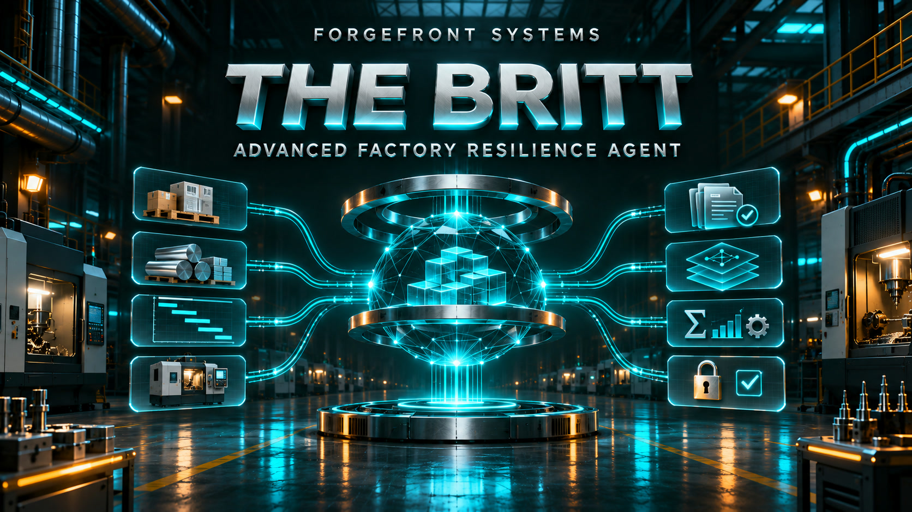

<!-- live-demo:start -->
**Live demo:** [Open the recovery room](https://forgefront-factory-resilience.onrender.com)
<!-- live-demo:end -->
**Demo video · 2:55:** [Watch the complete demonstration](https://justinevans4040-cloud.github.io/forgefront-factory-resilience/) · [Video details and MP4](https://github.com/justinevans4040-cloud/forgefront-factory-resilience/releases/tag/demo-video-v14)

  

# ForgeFront Factory Resilience

<strong>The shop floor is in trouble. The Britt finds the way forward. You make the call.</strong>

  <a href="https://forgefront-factory-resilience.onrender.com"><strong>LAUNCH THE LIVE APP</strong></a>
  &nbsp;&nbsp;·&nbsp;&nbsp;
  <a href="https://justinevans4040-cloud.github.io/forgefront-factory-resilience/"><strong>WATCH THE 2:55 DEMO</strong></a>
  &nbsp;&nbsp;·&nbsp;&nbsp;
  <a href="hackathon/docs/JUDGES_GUIDE.md"><strong>OPEN THE JUDGE GUIDE</strong></a>

## The factory emergency

Only **3 of 100 pieces arrived**. Two orders stop. The first is due in **36 hours**. Across the 45-machine reference floor, **10 machines are offline** and **19 more are starved downstream**—ready to work, but waiting for upstream parts that never arrived.

Factory Resilience turns that chain reaction into one inspectable recovery room. **The Britt** connects the certificate, receiving count, substitute stock, compatible capacity and waiting jobs; **Meta Muse models** investigate and explain; a deterministic engine calculates the tradeoffs; and a human authorizes the response.

| 97-piece discrepancy | 100 pieces at risk | 2 orders stopped | 10-hour capacity shortfall |
| :---: | :---: | :---: | :---: |
| Certificate **100** vs. received **3** | Source-linked to the held lot | Due in **36h** and **48h** | After Cell Mill 2 goes offline |

## Built to win on the judging rubric

| Judging signal | What Factory Resilience demonstrates |
| --- | --- |
| **Impact · 30%** | A firsthand manufacturing problem with immediate consequences: material discrepancies, idle equipment, missed schedules and expensive recovery decisions. |
| **Use of Meta AI Tooling · 25%** | Muse Spark Open investigates through bounded read-only tools; Muse Wonder supports recovery reasoning and task drafting; exact numerical claims must match source evidence. |
| **Technical Depth & Execution · 20%** | Deterministic capacity math, snapshot-bound human authorization, strict model-output validation, real disruption invalidation, evidence retention and a deployed public application. |
| **Demo · 25%** | A working live product, a complete 2:55 film and a repeatable end-to-end judging path from incident through downstream impact. |

Factory Resilience directly answers both event themes: **Build for Your World**, by solving a problem grounded in manufacturing operations, and **Push the Frontier**, by bringing source-bound agentic reasoning into a physical production system. See the [official event details](https://events.cerebralvalley.ai/e/meta-ai-developer-hackathon) and [event waiver](https://cerebralvalley.ai/e/meta-ai-developer-hackathon/waiver).

## What the judges should experience

1. **See the discrepancy.** The certificate says 100 pieces; receiving counted 3.
2. **Run The Britt.** Muse Spark Open on Baseten checks the records through five bounded, read-only factory tools.
3. **Compare the recovery.** Substitute material finishes in 40 hours for $4,500; split capacity finishes in 26 hours for $4,570.
4. **Approve the path.** The decision is bound to the exact plant snapshot. A production deployment would add an authorization wall such as a passkey, typed phrase, or other enterprise security control.
5. **Break the plan again.** Take Cell Mill 2 offline and watch 50 required hours collide with only 40 remaining hours.
6. **Inspect the proof.** Every important quantity traces to a document, record, line and retained workflow event.

For the most repeatable full judging path, select **Sample** on the Incident screen. To inspect the genuine model integration, run the live **Meta Muse Spark Open** route. Both modes are labeled in the interface and never masquerade as one another.

## Meet The Britt: advanced AI for factory recovery

  

**The Britt is the source-bound resilience agent at the center of Factory Resilience.** It does more than summarize an incident: it investigates the live recovery snapshot, connects material and receiving evidence to affected jobs and compatible machines, challenges unsupported claims, and turns the verified situation into an explainable recovery proposal for a human decision-maker.

Its advanced design comes from combining Meta models with strict operational boundaries:

- **Meta Muse Spark Open performs the investigation.** Running on Baseten, it can use five narrowly scoped, read-only factory tools to retrieve the certificate, receipt, inventory, job and capacity records needed for the incident.
- **Every numerical claim is source-checked.** A claim is accepted only when its document, record, field, value and unit agree with the underlying evidence. Fluent language cannot override a mismatched fact.
- **Meta Muse Wonder supports deeper recovery reasoning.** Through the Meta Model API, it can draft advisory recovery logic and structured tasks; the application rejects unavailable, malformed or unsupported output instead of treating it as a plan.
- **The model reasons; the engine calculates.** Stock coverage, machine compatibility, capacity, completion time and cost come from deterministic code, so The Britt cannot improvise the operational math.
- **Authority is snapshot-bound and human.** The Britt can recommend and explain, but it cannot release work. A person approves the current plan, and a changed factory state invalidates that prior authority.
- **The system fails closed.** Model identity, tool access, response structure and evidence claims are validated before results enter the workflow. Errors remain visible; they are not silently converted into a successful answer.

That separation—**Meta intelligence for investigation and reasoning, deterministic software for operational truth, and a human for authorization**—is what makes The Britt suitable for high-consequence manufacturing decisions.

## What drives The Britt—and what drives the math

| Responsibility | System of record | Why it matters |
| --- | --- | --- |
| Evidence investigation | **Meta Muse Spark Open on Baseten** | Calls only allowlisted read tools and must return claims that match exact source records. |
| Recovery reasoning and task drafting | **Meta Muse Wonder through the Meta Model API** | Produces advisory reasoning and proposed tasks; availability is account-dependent and invalid output is rejected. |
| Standby inference | **Muse Spark Open on Fireworks** | Configured as a standby host and excluded from normal public-demo traffic. |
| Stock, compatibility, capacity, time and cost | **Deterministic recovery engine** | The model never invents the 26h / $4,570 result or the 50h-versus-40h shortfall. |
| Decision authority | **Human approval bound to the current snapshot** | Model output cannot authorize work or survive a changed plant state. |
| Accountability | **Source-linked workflow evidence** | A reviewer can inspect what the system knew, calculated, proposed and accepted. |

[Read the complete Meta model integration](hackathon/docs/META_MODEL_USAGE.md) · [Inspect the architecture](hackathon/docs/ARCHITECTURE.md)

## The recovery room

Every application view is collected here—one complete walkthrough, without turning the rest of the repository into a screenshot wall.

| Shop-wide impact | Incident | Verified findings |
| --- | --- | --- |
|  |  |  |
| **See the cascade.** Follow the held lot into offline and starved equipment. | **Find the mismatch.** Connect 100 promised pieces, 3 received pieces and two stopped orders. | **Verify the facts.** Open the evidence behind every material, job and capacity claim. |
| Recovery decision | Human authorization | The Britt plan |
|  |  |  |
| **Compare tradeoffs.** See feasibility, coverage, finish time and cost together. | **Make the call.** Nothing advances until a person accepts the path. | **Turn the decision into work.** Review assignments and tasks before approval. |
| Second disruption | Evidence | Model and session controls |
|  |  |  |
| **Test resilience.** The old decision is invalid when the plant changes. | **Retain the reasoning.** Review sources, assumptions and the decision record. | **Inspect the boundary.** See the connected tools, identity and active snapshot. |

## Why this is more than a dashboard

Most factory systems report what already happened. Factory Resilience shows **why work is stopping, which downstream assets are exposed, what recovery paths are feasible and which evidence supports the decision**—before the disruption becomes a missed schedule.

- It connects material, jobs, compatible machines and source evidence in one decision surface.
- It separates model reasoning from deterministic operational math.
- It rejects unsupported numerical claims instead of polishing them into confident prose.
- It invalidates old authority when the factory snapshot changes.
- It keeps humans responsible for the decision and the task plan.
- It demonstrates a path from an independent machine shop to connected global production.

## The ForgeFront vision

Factory Resilience begins with one held lot, two urgent jobs and a shop that cannot afford another surprise. The same decision pattern can scale across the manufacturers that keep critical production moving.

<table>
  <tr>
    <td width="50%"></td>
    <td width="50%"></td>
  </tr>
  <tr>
    <td width="50%"></td>
    <td width="50%"></td>
  </tr>
</table>

## Engineering proof, without the data dump

The repository keeps deep verification available for judges who want it, while the main story stays focused on the product.

| Review area | Evidence |
| --- | --- |
| Working product | [Live recovery room](https://forgefront-factory-resilience.onrender.com) · [Complete demonstration](https://justinevans4040-cloud.github.io/forgefront-factory-resilience/) |
| Judge path | [Judge walkthrough](hackathon/docs/JUDGES_GUIDE.md) · [Prepared submission narrative](hackathon/docs/SUBMISSION_DRAFT.md) |
| Model integration | [Meta model usage](hackathon/docs/META_MODEL_USAGE.md) · [Architecture and model roles](hackathon/docs/ARCHITECTURE.md) |
| Technical design | [Architecture](hackathon/docs/ARCHITECTURE.md) · [Calculation boundaries](hackathon/docs/FIXTURE_RUNTIME_ALIGNMENT.md) |
| Trust and safety | [Security controls](hackathon/SECURITY_CONTROLS.md) · [Claim proof](hackathon/docs/CLAIM_PROOF.md) |
| Verification | [Current evidence index](hackathon/evidence/README.md) · [Submission checklist](hackathon/docs/SUBMISSION_CHECKLIST.md) |

[**Open the live app**](https://forgefront-factory-resilience.onrender.com) · [**Watch the 2:55 demo**](https://justinevans4040-cloud.github.io/forgefront-factory-resilience/) · [Run it yourself](hackathon/RUN_GUIDE.md)

---

Built by **ForgeFront Systems**.

**Built for a safe, complete demonstration.** The judging environment runs on a fully populated factory scenario: a 45-machine dependency map reveals the downstream cascade, while a source-bound two-cell snapshot drives the recovery comparison. Factory Resilience carries the workflow from evidence and model-assisted investigation through deterministic recovery math and verified human authorization. A production deployment would connect that approved decision package to the plant's certified scheduling and machine-control systems. Source code is available under the [MIT license](LICENSE).
