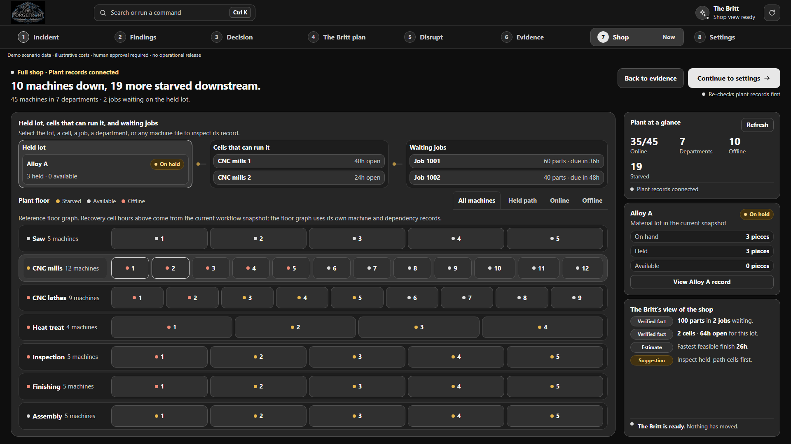
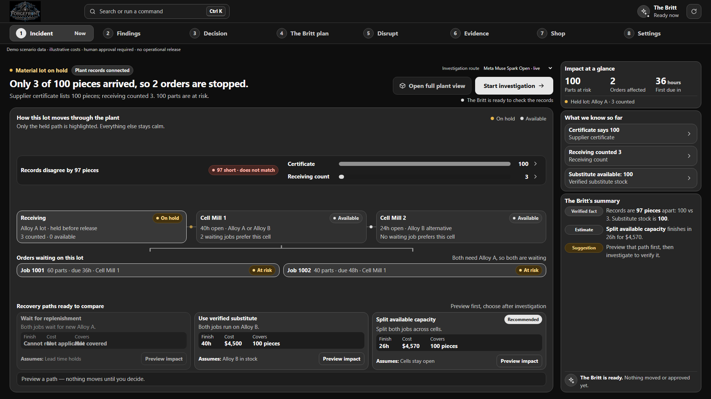
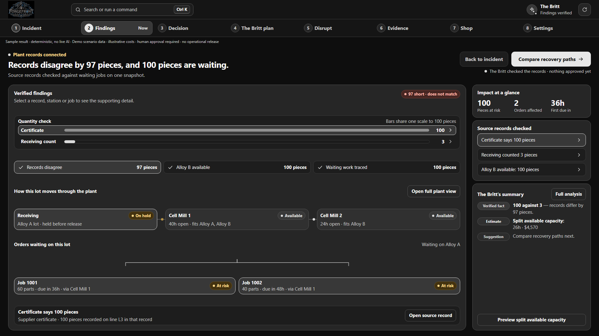
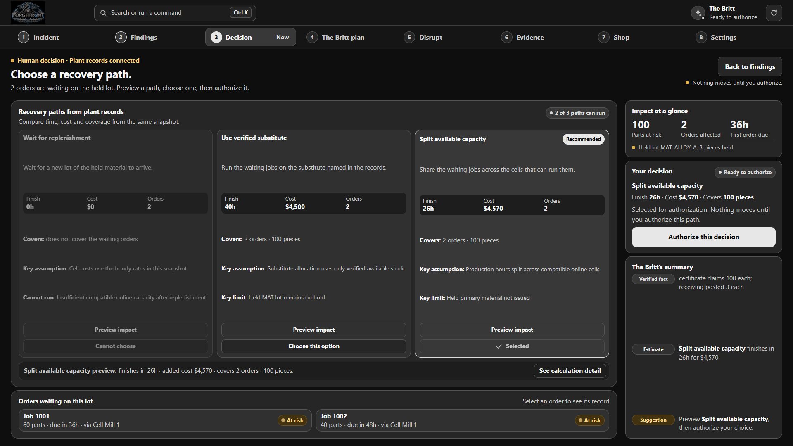
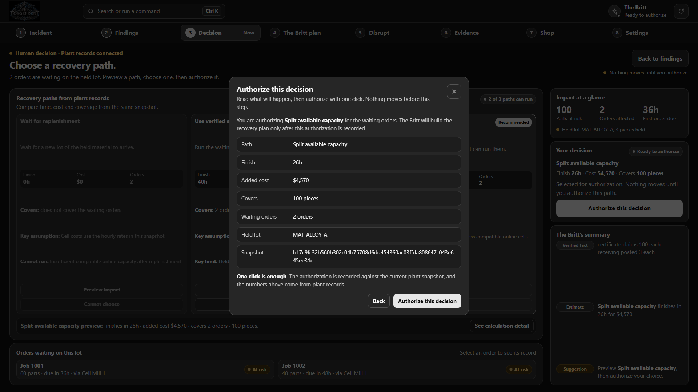
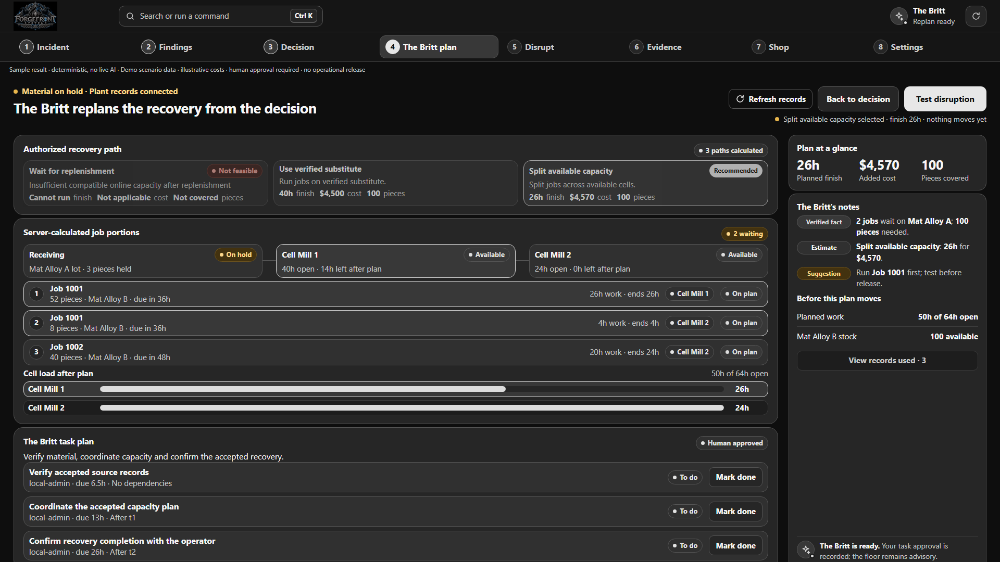
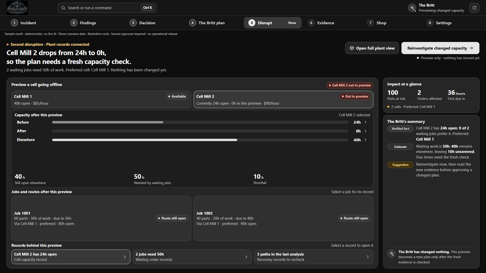
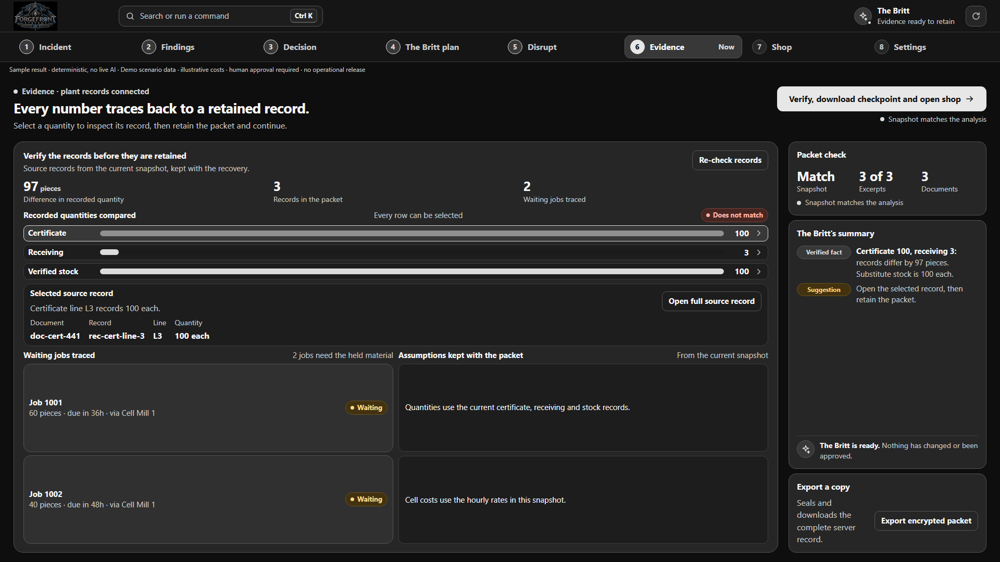
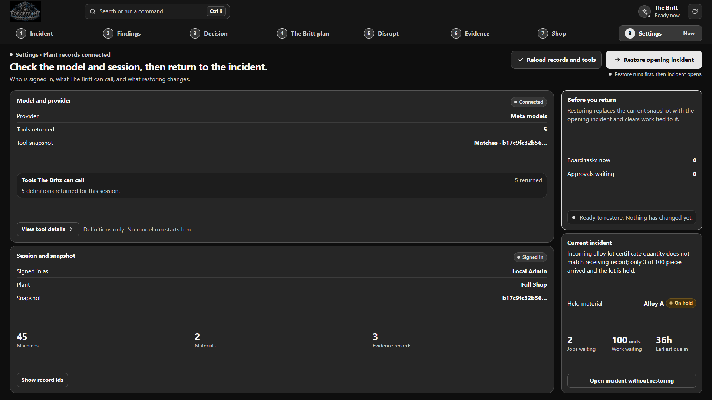

<!-- live-demo:start -->
**Live demo:** [Open the recovery room](https://forgefront-factory-resilience.onrender.com)
<!-- live-demo:end -->

# ForgeFront Factory Resilience

**The shop floor is in trouble. The Britt finds the way forward. You make the call.**

Only **3 of 100 pieces arrived**. **10 of 45 machines are offline**, with **19 more starved downstream**. Two orders need 100 pieces, and the first is due in 36 hours. A shortage at receiving has become a factory emergency.

ForgeFront Factory Resilience connects the material hold, source records, machine capacity and waiting jobs in one recovery room. **The Britt**, powered by **Meta Muse models**, investigates the discrepancy, explains calculated recovery choices and turns your authorized decision into a plan you can inspect.

## The emergency across the shop

**Shop.** Trace the held Alloy A lot through available cells and waiting jobs. The plant floor shows every machine across Saw, CNC mills, CNC lathes, Heat treat, Inspection, Finishing and Assembly, with filters for the held path, online machines and offline machines.

## From incident to recovery

### Incident

**Find the discrepancy.** The supplier certificate lists 100 pieces; receiving counted 3. Inspect the 97-piece gap, follow the held material into two waiting orders, and preview recovery paths before starting The Britt's investigation.

### Findings

**Check the evidence.** The Britt brings certificate, receiving and substitute-stock records into one snapshot. Open the supporting record behind a quantity, station or job, then compare the calculated recovery paths.

### Decision

**Choose the tradeoff.** Compare feasibility, time, cost and coverage. In this snapshot, verified substitute finishes in 40 hours for $4,500; splitting available capacity finishes in 26 hours for $4,570. Replenishment cannot cover the waiting orders with the available capacity.

### Authorize

**Make the call.** Review the selected path, waiting orders, held lot and exact snapshot before recording your authorization. The Britt builds the recovery plan from that choice.

### The Britt plan

**See how the work fits.** Inspect the replanned assignments, material, due times and remaining cell capacity. The screen keeps the selected recovery, 50 hours of planned work, available substitute stock and source records beside the job assignments.

### Disrupt

**Test the next failure.** Preview Cell Mill 2 going offline. With 50 hours needed and 40 hours remaining elsewhere, the screen exposes a 10-hour shortfall and offers a fresh investigation of the changed capacity.

### Evidence

**Keep the reasoning with the decision.** Inspect the source document, record and line behind each quantity. Check the packet against the analysis snapshot, review the waiting jobs and assumptions, and export a copy of the evidence.

### Settings

**Inspect the connection.** Check model availability, the session and the plant snapshot. Review what restoring the opening incident will replace, or return to Incident with the current work intact.

## Powered by Meta models

**Muse Spark Open on Baseten** powers The Britt's investigation of factory evidence through read-only calls. **Muse Wonder through the Meta Model API** reasons over recovery choices and supports recovery planning. The recovery engine computes stock, capacity, feasibility, hours and cost from the current snapshot. The models explain the options; your authorization records the decision.

## Why ForgeFront

A material hold spreads through connected work. ForgeFront makes that chain visible, puts source evidence beside the numbers, and carries the chosen recovery into job assignments. When capacity changes, you can see the shortfall and investigate again with the new facts.

[Open the recovery room](https://forgefront-factory-resilience.onrender.com)  [Run it yourself](hackathon/RUN_GUIDE.md)  [Meta model integration](hackathon/docs/META_MODEL_USAGE.md)

Built by **ForgeFront Systems**.
