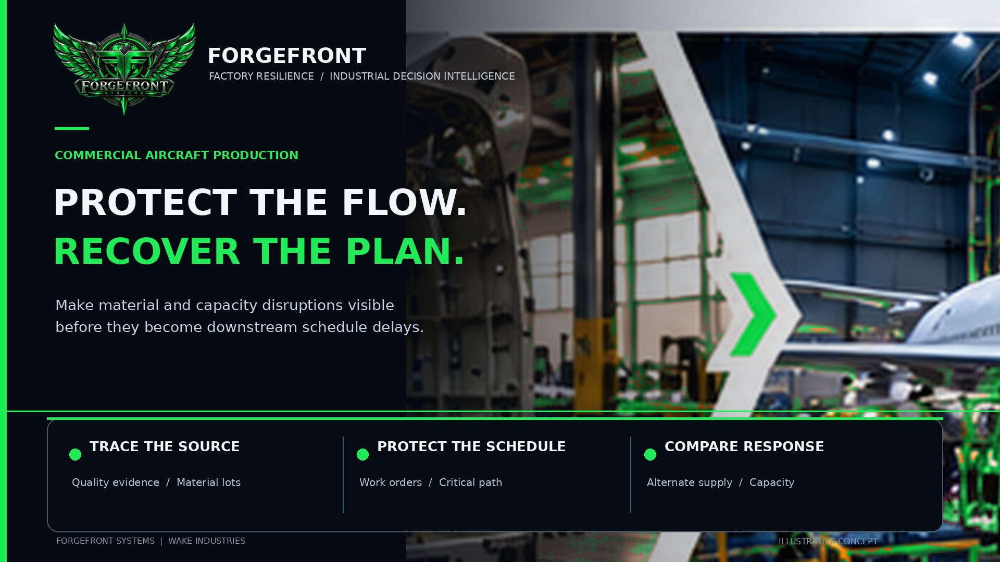
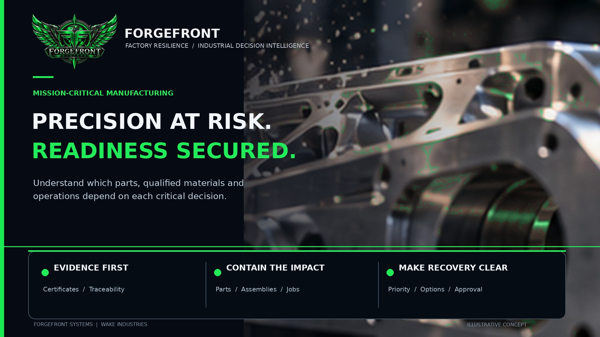
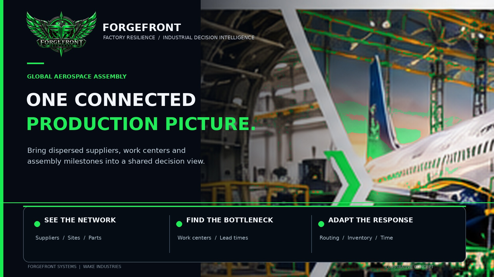
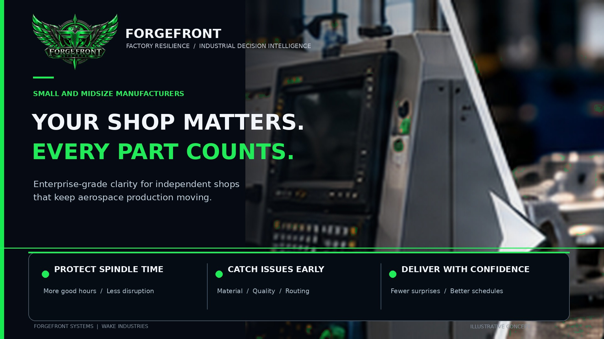
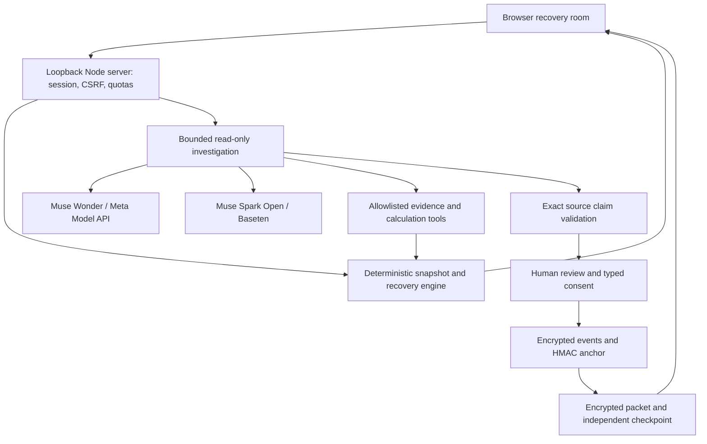

<p align="center">

</p>

# Forgefront Factory Resilience

### When a bad material cert stops the line, Forgefront gets it moving again — with Meta AI on the evidence and a human on the decision.

A disputed material certificate can freeze production for days while teams chase paperwork, hunt for substitute stock and redo the schedule by hand. **Forgefront turns that scramble into one recovery room.** Meta's Muse models investigate the source records with read-only tools, a deterministic engine computes three recovery plans from the live factory snapshot, and a human accepts one with a typed, single-use consent. Hit it with a second shock — a machine goes down — and Forgefront invalidates the stale decision, re-investigates and recovers again. Every step lands in a tamper-evident, encrypted ledger.

- **Evidence-grounded AI** — every model claim is checked against exact server-built source records; anything unverified is visibly marked.
- **Two Meta models, one snapshot** — run Muse Spark Open and Muse Wonder on the same factory state and compare them side by side.
- **Math you can trust** — quantities, capacity, feasibility and hours come from a deterministic engine, not the model.
- **Built for the second shock** — constraint changes automatically invalidate prior acceptance and force a fresh decision.
- **Provable decisions** — hash-chained, HMAC-anchored ledger with encrypted export and an independent checkpoint verifier.
- **Zero dependencies** — one command, no install, no build step.

## Manufacturing contexts

### Aircraft production



Material and supplier issues are connected to production assignments, downstream assemblies and delivery commitments, so teams can identify affected work and evaluate where production can continue.

### Mission-critical programs



Source-linked evidence and documented decisions support investigations where material identity, production dependencies and the reasoning behind a response need to remain traceable.

### Connected assembly operations



Recovery comparisons account for inventory, production orders, work cells and machine capacity, and are recomputed when a second shock changes factory constraints.

### Independent shops and suppliers



Material investigation, CNC scheduling and recovery comparison live in the same workflow, so operators can examine affected jobs, compare material and capacity choices, and preserve the evidence behind their response.

## Run it in 60 seconds

Node.js 20+ and a browser. Nothing to install.

```sh
# Meta keys in the server environment
export MUSE_API_KEY=...          # Muse Wonder (Meta Model API)
export BASETEN_API_KEY=...       # Muse Spark Open (Baseten)

npm run demo --prefix hackathon
```

Open **http://127.0.0.1:8791** — the demo opens straight into the recovery room. Click **Start guided recovery**. No keys handy? Pick **Sample · offline walkthrough; no live AI** in the route selector to walk the full workflow offline. Before filming, run `npm run check:providers --prefix hackathon` for a GREEN/RED live route check, then use **Check selected route** in the room. More options in the [run guide](hackathon/RUN_GUIDE.md).

## 3-minute demo path

1. **Understand** — start the guided scenario and open the certificate discrepancy and its source records.
2. **Investigate** — run Muse Spark Open on Baseten, then Muse Wonder, on the same snapshot. Compare validated claims, tool traces and latency.
3. **Decide** — weigh replenishment, verified substitution and split-capacity plans, then accept one by typing its exact consent phrase.
4. **Challenge** — take a machine offline. Watch the earlier acceptance get invalidated, re-investigate and accept a revised plan.
5. **Prove** — verify the tamper-evident ledger and export an encrypted evidence packet with its independent checkpoint.

The guide advances on real application state. Shot-by-shot: [demo runbook](hackathon/docs/DEMO_RUNBOOK.md).

## How Meta models are used

| Model | Host | What it does |
|---|---|---|
| **Muse Spark Open** (`meta-models/muse-spark-open`) | Baseten | The investigator: drives a bounded loop of read-only evidence and calculation tools to trace the certificate discrepancy and test recovery options |
| **Muse Wonder** (`muse-wonder-1.0`) | Meta Model API | The strategist: writes the recovery story and counterfactual tradeoffs for the plans on the table |

Meta models are the only AI in the product, locked to an allowlist of these exact routes. The observed-run comparison shows each model's identity, latency and accepted versus rejected claims on the same snapshot. Details: [Meta model usage](hackathon/docs/META_MODEL_USAGE.md).



## Security built in

- **Session and CSRF protection** with Host/Origin checks on every request.
- **Role separation** — distinct admin, operator and auditor permissions.
- **Single-use, expiring consent** sealed to the deciding identity.
- **AES-256-GCM encrypted ledger** with hash-chain and HMAC integrity verified at startup, on every workflow operation and on demand.
- **Crash-safe recovery** — encrypted write-ahead intent completes interrupted appends forward.
- **Encrypted exports by default** — scrypt plus AES-GCM with a separate passphrase.
- **Encrypted, persistent rate limits and quotas** that fail closed.
- **Secret scanning in CI** with checksum-pinned gitleaks and commit-pinned actions.

Full control mapping: [SECURITY_CONTROLS.md](hackathon/SECURITY_CONTROLS.md).

## Verify it yourself

```sh
npm test --prefix hackathon
npm run check:judge --prefix hackathon
npm run check:public-tree --prefix hackathon
npm run check:providers --prefix hackathon
npm run check:a11y --prefix hackathon
npm run smoke:browser --prefix hackathon
```

The suite runs without credentials and covers recovery arithmetic, provider allowlists, evidence rejection, consent replay, ledger recovery, quotas and exports. Current proof index: [`hackathon/evidence/README.md`](hackathon/evidence/README.md).

## Contributions and license

Built by **Forgefront Systems**. [HACKATHON_CONTRIBUTIONS.md](hackathon/HACKATHON_CONTRIBUTIONS.md) · [THIRD_PARTY_NOTICES.md](hackathon/THIRD_PARTY_NOTICES.md) · [LICENSE](LICENSE)
