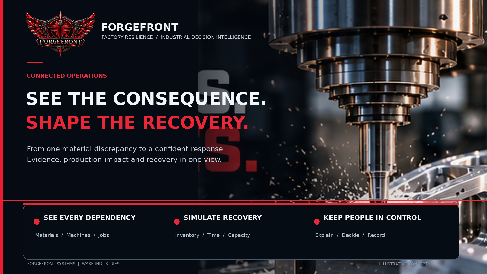
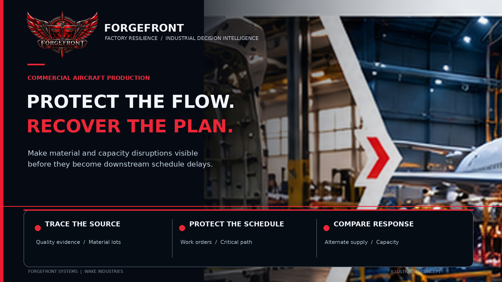
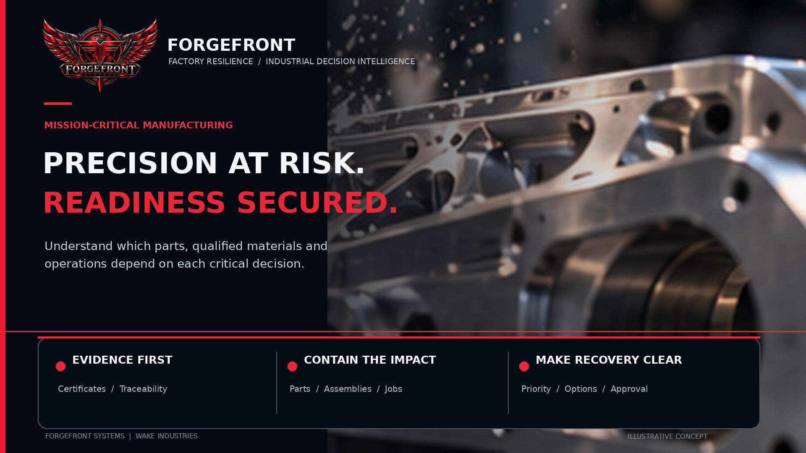
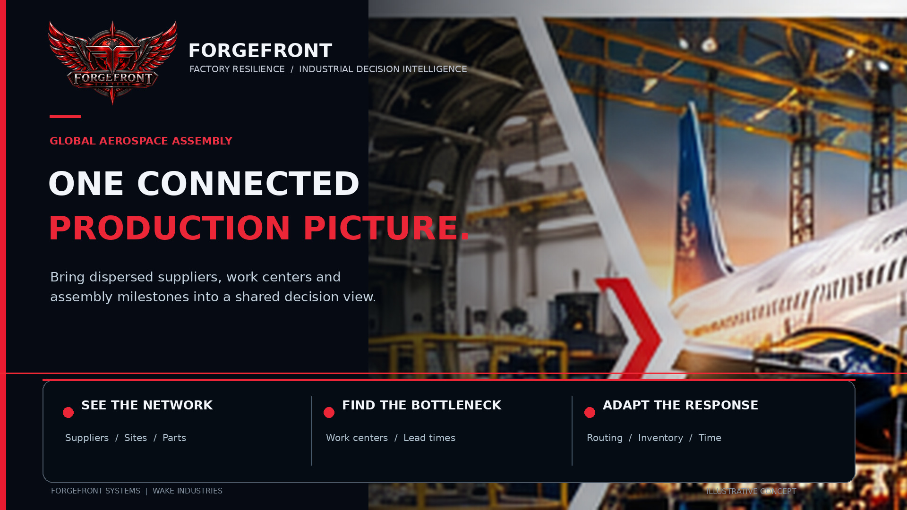
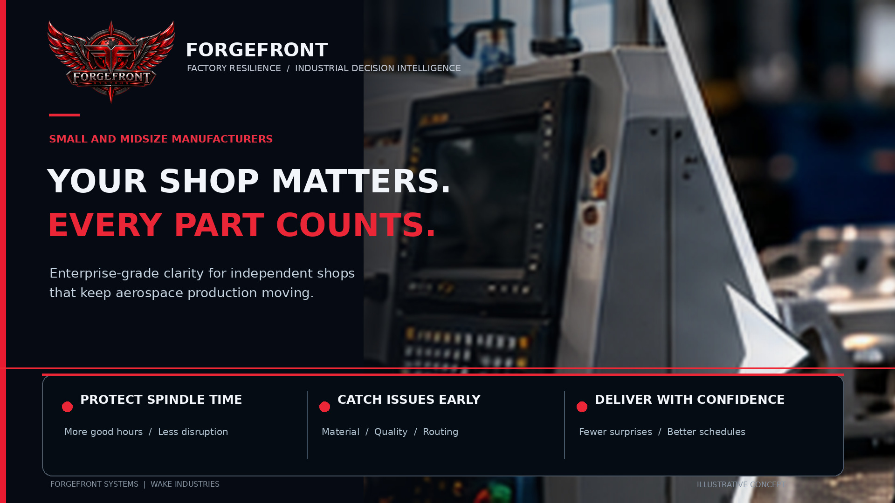

# ForgeFront Factory Resilience

ForgeFront Factory Resilience is an AI-assisted manufacturing investigation and recovery-planning platform. It connects material evidence, production relationships, machine capacity, and schedules to help operators understand a disruption, compare practical responses, and record a decision with supporting evidence.

Developed by ForgeFront Systems / Wake Industries for the Meta Global AI Developer Hackathon 2026, the project focuses on a concrete operational challenge: turning fragmented manufacturing records into a coordinated recovery plan.

## From material evidence to a production decision

A conflicting material certificate can affect inventory, production assignments, and delivery commitments. Factory Resilience brings the investigation and its operational consequences into a shared command experience.

The workflow follows the operator's decision process:

1. **Examine the evidence.** Extract material details and compare an incoming certificate with the scenario master record, retaining source line references.
2. **Trace affected production.** Connect the material finding to the jobs and material units involved.
3. **Compare recovery options.** Calculate alternatives using material availability, time constraints, and work-cell schedules.
4. **Explore changing conditions.** Recompute plans as stock and operating assumptions change.
5. **Record the response.** Capture the operator's scenario selection, incident events, and a structured evidence report.

## The factory demonstration

The aerospace machining scenario contains **40 production orders across four CNC work cells**. An incoming material record contains a heat-number conflict. The investigation maps the incident to **seven production jobs and 178 material units**, then calculates **four recovery alternatives**.

Operators can explore how changed stock and operating assumptions affect the response, review the resulting schedules, and record their chosen approach. The demonstration connects the source record to a production decision through visible evidence and calculations.

The [October 17 foundation milestone](docs/BUILD_VERIFICATION_2026-10-17.md) records **13 passing automated tests** and browser acceptance exercises covering certificate correction, incident reinjection, recovery recalculation, decision recording, and decision refresh after conditions change. The command interface was examined on desktop and at a **390-pixel mobile viewport**.

## Manufacturing contexts

### Aircraft production

The project is designed to connect material and supplier issues with production assignments, downstream assemblies, and delivery commitments. That visibility helps teams identify affected work and evaluate where production can continue.

### Mission-critical programs

Source-linked evidence and documented decisions support investigations where material identity, production dependencies, and the reasoning behind a response need to remain traceable.

### Connected assembly operations

The development plan extends the dependency model across inventory assignments, production orders, work cells, assemblies, and delivery milestones. Recovery comparisons account for available resources and changing factory constraints.

### Independent shops and suppliers

The factory scenario brings material investigation, CNC scheduling, and recovery comparison into the same workflow. Operators can examine the affected jobs, compare material and capacity choices, and preserve the evidence behind their response.

## Meta hackathon development

The competition program builds on the factory foundation with multi-document investigation, Meta AI reasoning, broader production consequence mapping, and adaptive recovery planning.

The planned Meta AI workflow uses structured, source-linked scenario facts to explain document relationships, operational consequences, and decision alternatives. Evaluation compares those explanations with independently calculated scenario results.

The planned adaptive recovery demonstration introduces a second change to material availability, supply timing, or machine capacity. It compares hold-and-reconcile, expedited supply, inventory reallocation, and hybrid strategies, showing how new constraints change the recovery decision.

## Project documentation

The development program spans 13 phases, from the factory foundation through investigation, recovery planning, operator experience, validation, and competition submission.

- [Master Build Phase Sheet](docs/MASTER_BUILD_PHASE_SHEET.md) — Scope, deliverables, and acceptance criteria for each phase.
- [Phase Board](docs/PHASE_ISSUE_INDEX.md) — Phase schedules and linked GitHub issues.
- [Build Roadmap](docs/BUILD_ROADMAP.md) — Development stages and delivery milestones.
- [Foundation Milestones](docs/BUILD_VERIFICATION_2026-10-17.md) — Demonstrated capabilities and engineering verification.

---

Copyright © 2026 Justin Evans / ForgeFront Systems. [License](LICENSE)
