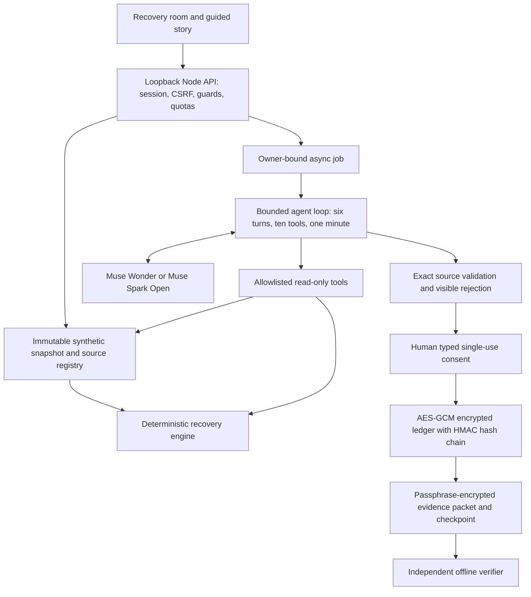

# ForgeFront Factory Resilience

**Evidence before action for factory disruptions, built on Meta Muse models.**

Meta Hackathon build for the Cerebral Valley x Meta Global AI Developer Hackathon (Indie track).

[](https://github.com/justinevans4040-cloud/forgefront-factory-resilience/actions/workflows/ci.yml)

## The problem

When a supplier certificate doesn't match what arrived at the dock, a plant has minutes to decide: hold the line, substitute material, or reschedule. Today that call is made from scattered PDFs, ERP screens and tribal knowledge, and nobody can later prove *why* a decision was made. AI can speed this up, but an AI that silently "approves" material is a safety and compliance risk.

## What it does

ForgeFront turns a manufacturing discrepancy into a **source-grounded recovery investigation**:

1. A Meta model investigates through bounded, read-only tools over an immutable snapshot of evidence (certificates, receipts, inventory, machine capacity).
2. Every quantitative claim must cite an exact source record. Unsupported or invented claims are **visibly rejected**.
3. A deterministic engine (not the model) computes stock, capacity, feasibility, hours and illustrative cost.
4. A named human types a single-use consent to accept the advisory plan. No model can release material, change inventory or run equipment (`operationalRelease` is always `false`).
5. When a second shock hits (a machine outage), prior decisions are invalidated and the case is reinvestigated.
6. The whole disruption-to-recovery history lands in an encrypted, tamper-evident ledger and an exportable evidence packet that can be verified offline.

All factory data is synthetic and costs are illustrative.

## Meta models used

The product's AI runs only on Meta models. No other model provider is used at runtime.

| Role | Model | Host |
| --- | --- | --- |
| Recovery story and counterfactual | `muse-wonder-1.0` (Muse Wonder) | Meta Model API, `https://api.meta.ai/v1/responses` |
| Tool-using investigator | `meta-models/muse-spark-open` (Muse Spark Open) | Baseten |
| Tool-using investigator (operator-selected alternative) | `accounts/fireworks/models/muse-spark-open` (Muse Spark Open) | Fireworks |

Model identities are allowlisted. There is no arbitrary inference URL, no model override and no silent provider switch. Details: [hackathon/docs/META_MODEL_USAGE.md](hackathon/docs/META_MODEL_USAGE.md) and [hackathon/docs/MODEL_COMPARISON.md](hackathon/docs/MODEL_COMPARISON.md).

## Quickstart

Requires Node 20 or newer. Zero runtime npm dependencies, no build step.

```sh
git clone https://github.com/justinevans4040-cloud/forgefront-factory-resilience.git
cd forgefront-factory-resilience
npm run demo --prefix hackathon
```

Open http://127.0.0.1:8791 and sign in with the public demo token `synthetic-browser-rehearsal`.

For live Meta model runs, set these in your shell environment before starting (see [.env.example](.env.example); never commit values):

```
MUSE_API_KEY        # Meta Model API (Muse Wonder)
BASETEN_API_KEY     # Muse Spark Open on Baseten
FIREWORKS_API_KEY   # Muse Spark Open on Fireworks
```

Missing keys fail closed. An offline sample mode exists only when chosen explicitly and is labeled `SAMPLE - OFFLINE; NO LIVE AI`.

## Demo walkthrough (about 3 minutes)

1. Choose **Start guided synthetic scenario**, then **Show next action**. The guide advances on real app state, never a timer.
2. Open the sources: a certificate says 120 units, the receipt says 80.
3. Run the investigation on Muse Spark Open (Baseten or Fireworks) and the recovery story on Muse Wonder, against the same snapshot.
4. Review accepted versus rejected claims, then type consent to accept the advisory plan.
5. Trigger a machine outage. The snapshot digest changes, the old decision is invalidated, and you reinvestigate.
6. Accept the new plan and export a passphrase-encrypted evidence packet plus a checkpoint for offline verification.

Full runbook: [hackathon/docs/DEMO_RUNBOOK.md](hackathon/docs/DEMO_RUNBOOK.md).

## Architecture



More: [hackathon/docs/ARCHITECTURE.md](hackathon/docs/ARCHITECTURE.md), [hackathon/docs/API_CONTRACT.md](hackathon/docs/API_CONTRACT.md).

## Security

Designed against SOC 2-style controls, documented in [hackathon/SECURITY_CONTROLS.md](hackathon/SECURITY_CONTROLS.md):

- Fail closed when keys are missing; keys come only from environment variables and are never logged
- Session auth, CSRF protection, per-client rate limits and durable quotas, separate operator and auditor roles
- AES-256-GCM encryption at rest, HMAC hash-chained tamper-evident ledger, crash-safe write-ahead recovery
- Prompt-injection defenses: read-only tools, schema validation, exact source matching
- Encrypted exports by default (scrypt + AES-GCM); plaintext exports require explicit acknowledgement
- CI runs the test suite and a gitleaks secret scan on every push

This project has **not** undergone a SOC 2 audit and makes no SOC 2 certification claim.

## Verify it yourself

```sh
npm test --prefix hackathon                    # 112 tests, no API keys needed
npm run smoke:browser --prefix hackathon       # offline browser flow (needs Chrome or Edge)
npm run smoke:meta --prefix hackathon          # live calls to all three Meta routes (needs keys)
```

Recorded run evidence (screenshots, packets, provider results) is in [hackathon/evidence](hackathon/evidence).

## Built during the hackathon

Everything in this repository was built for the hackathon: the Meta model clients and allowlist, the bounded tool-using investigation loop, source validation, the deterministic recovery engine, the guided recovery room UI, the encrypted tamper-evident ledger, consent flow, exports and offline verifier, and the test suite. See [hackathon/HACKATHON_CONTRIBUTIONS.md](hackathon/HACKATHON_CONTRIBUTIONS.md). Cursor and Codex were used as development tools only; they are not part of the product.

## License

See [LICENSE](LICENSE). Third-party notices: [hackathon/THIRD_PARTY_NOTICES.md](hackathon/THIRD_PARTY_NOTICES.md).