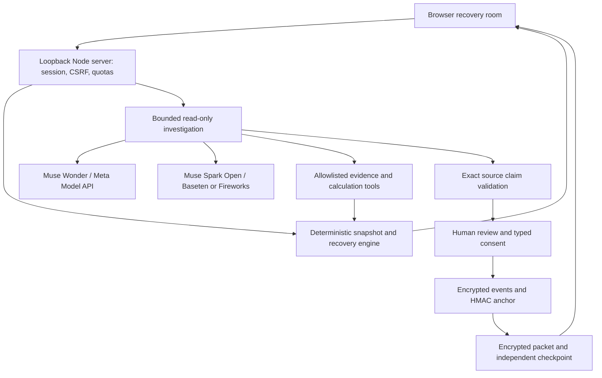

<p align="center">

</p>

# ForgeFront Factory Resilience

**A factory recovery room where Meta AI investigates, calculations establish feasibility, and a human records the decision.**

A disputed material certificate can hold production while teams reconcile evidence, find substitute stock and restore a workable schedule. ForgeFront connects those steps: inspect the source discrepancy, compare three recovery plans computed from the current factory snapshot, investigate with read-only Meta model tools, and retain an inspectable decision trail. A second machine outage changes the constraints and invalidates the earlier acceptance.

The judge entry is the Meta Hackathon build under [`hackathon/`](hackathon/README.md). Factory records are synthetic, costs illustrative, and every decision advisory: `operationalRelease` is always `false`. This is a local engineering demonstration. It does not control machinery or release material.

## Manufacturing contexts

### Aircraft production


Material and supplier issues are connected to production assignments, downstream assemblies and delivery commitments, so teams can identify affected work and evaluate where production can continue.

### Mission-critical programs


Source-linked evidence and documented decisions support investigations where material identity, production dependencies and the reasoning behind a response need to remain traceable.

### Connected assembly operations


Recovery comparisons account for inventory, production orders, work cells and machine capacity, and are recomputed when a second shock changes factory constraints.

### Independent shops and suppliers


Material investigation, CNC scheduling and recovery comparison live in the same workflow, so operators can examine affected jobs, compare material and capacity choices, and preserve the evidence behind their response.

## Start the recovery room

Use **Node.js 20 or later**, npm and a current browser. No npm dependencies, installation or build step are required. From the repository root:

```sh
npm run demo --prefix hackathon
```

Open **http://127.0.0.1:8791** and use the public synthetic rehearsal token shown on the sign-in screen. This isolated loopback demo creates fresh disposable state on each launch. Stop it with **Ctrl+C**.

- **With keys:** securely provision `MUSE_API_KEY` (or `MODEL_API_KEY`) for Wonder and `BASETEN_API_KEY` or `FIREWORKS_API_KEY` for Spark Open in the server's environment, then run the same command. Select the route explicitly. No inference starts automatically.
- **Without keys:** run the same command, open the investigation-route selector and deliberately choose **SAMPLE - OFFLINE; NO LIVE AI**. Sample exercises the local workflow but cannot satisfy the live guided-demo gates. Missing live credentials fail closed; there is no automatic Sample substitution.

Both environment templates contain empty values only. The app does not auto-load `.env`. Keep real keys, tokens, export passphrases and local state out of source, logs, screenshots and issues. See the [run guide](hackathon/RUN_GUIDE.md) for persistent operation, named roles and checkpoint verification.

## Three-minute demo story

Actual provider latency can extend a rehearsal; the guide advances on observed state, never a timer. The [shot-by-shot runbook](hackathon/docs/DEMO_RUNBOOK.md) and [caption draft](hackathon/docs/CAPTIONS_DRAFT.srt) support filming.

1. **Understand:** authenticate, start the guided synthetic scenario and inspect the certificate discrepancy and source records.
2. **Investigate:** run Spark Open, then Wonder on the same snapshot. Compare source-validated claims, read-only tool traces, latency and explicitly unvalidated narrative.
3. **Decide:** compare replenishment, verified substitution and split-capacity plans. Review a feasible option and type its exact acceptance phrase.
4. **Challenge:** take a machine offline. Observe invalidated acceptance, investigate the changed snapshot and deliberately accept a revised plan.
5. **Prove:** verify the hash-chained, tamper-evident ledger. Export an encrypted packet with a separate strong passphrase and retain its independent checkpoint separately.

No filmed video or completed submission is claimed here. [Contribution disclosure](hackathon/HACKATHON_CONTRIBUTIONS.md) identifies the hackathon work and separates legacy reference code. [Plan coverage](hackathon/docs/PLAN_COVERAGE.md) and the [submission checklist](hackathon/docs/SUBMISSION_CHECKLIST.md) retain the owner-only gates.

## Meta models in the product

| Model | Host and exact route | Role |
|---|---|---|
| Muse Wonder (`muse-wonder-1.0`) | Meta Model API, `https://api.meta.ai/v1/responses` | Evidence investigation, advisory recovery narrative and counterfactual tradeoffs |
| Muse Spark Open (`meta-models/muse-spark-open`) | Baseten, `https://inference.baseten.co/v1/chat/completions` | Bounded read-only recovery investigation |
| Muse Spark Open (`accounts/fireworks/models/muse-spark-open`) | Fireworks, `https://us.api.fireworks.ai/inference/v1/chat/completions` | Explicit alternative Spark Open host |

The hackathon product uses only these Meta routes. Deterministic calculations own quantities, feasibility, duration and illustrative cost. Claims require exact server-built evidence matches; free narrative remains visibly unvalidated. Model identity is checked against the allowlist but is provider-reported, not independent attestation. Failures retain labeled trace evidence, with no automatic retry or provider switch. See [model usage](hackathon/docs/META_MODEL_USAGE.md).



## Security and limits

[SECURITY_CONTROLS.md](hackathon/SECURITY_CONTROLS.md) maps **SOC 2-style control themes** to implementation and tests. This is **not SOC 2 certification**, an attestation, a complete accessibility audit or a production-safety claim.

The demo includes session/CSRF protection, Host/Origin checks, encrypted persistent quotas that fail closed, capped failed-login auditing, separated admin/operator/auditor permissions, expiring single-use sealed consent, encrypted verified ledger recovery and pinned-scrypt AES-GCM evidence export. Advanced plaintext downloads require acknowledgement. A privileged local attacker controlling keys and all anchors remains outside the authenticity guarantee. HTTP is loopback-only; no remote transport-security claim is made. Use synthetic data only. Keep vulnerability reports private through the repository security reporting interface.

## Verify locally

```sh
npm test --prefix hackathon
npm run check:judge --prefix hackathon
npm run check:public-tree --prefix hackathon
npm run smoke:browser --prefix hackathon
```

The hackathon suite exercises deterministic arithmetic, provider allowlists, evidence rejection, consent/replay, recovery, quotas, exports and public readiness without live credentials. `check:judge` audits the exact public text set, README script names and demo dependency closure. Browser smoke needs local Chrome/Edge (`CHROME_PATH` overrides discovery); on Node 20 enable WebSocket with `NODE_OPTIONS=--experimental-websocket`. Add `-- --live --guided` to the browser command for the real Meta flow, and `-- --live --guided --mobile` for the mobile-width flow. Supply keys privately. Sample smoke is explicitly offline.

CI runs the public test suite, public-tree isolation and judge checks and checksum-pinned gitleaks without provider secrets, using read-only permissions and commit-pinned actions. Local run-eight and run-nine outcomes live under [`hackathon/evidence/run8/changed-files.json`](hackathon/evidence/run8/changed-files.json) and [`hackathon/evidence/run9/public-tree.txt`](hackathon/evidence/run9/public-tree.txt); hosted CI for uncommitted changes is not claimed.

## Contributions and license

See [HACKATHON_CONTRIBUTIONS.md](hackathon/HACKATHON_CONTRIBUTIONS.md) and [THIRD_PARTY_NOTICES.md](hackathon/THIRD_PARTY_NOTICES.md). The root runtime and vendored Command Center are historical reference and are excluded from the hackathon demo.

The existing [LICENSE](LICENSE) is **proprietary, all rights reserved**. Public visibility allows judges to inspect the source; it does not grant an open-source license or permission to reuse it. No license grant or rights clearance is invented by this build.
