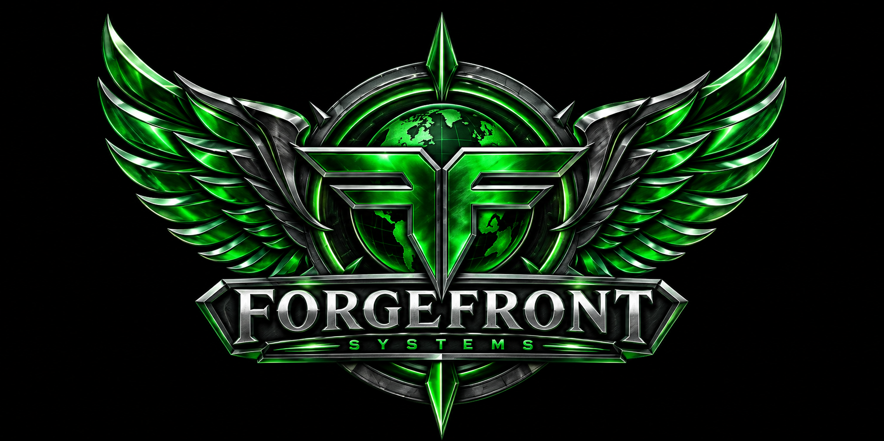
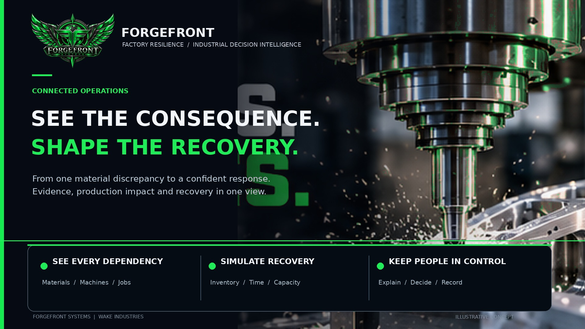
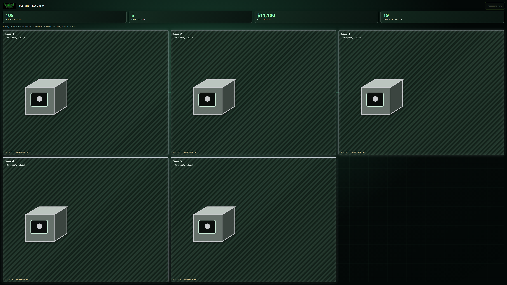

# Forgefront Factory Resilience

**A factory disruption becomes a recovery plan—with Meta AI investigating and a human making the call. The Britt turns that authorized decision into a live floor plan.**

| | | |
| ---: | ---: | ---: |
| **120** certificate | **80** receiving | **70** parts at risk |

Forgefront turns that freeze into a sealed recovery with Meta on the evidence and a human on the call.

<a href="https://forgefront-factory-resilience.onrender.com" style="display:inline-block;min-height:32px;padding:6px 4px;outline-offset:4px"><strong style="font-size:24px;line-height:1.35;color:#A8F04A;border-bottom:2px solid #A8F04A;letter-spacing:.02em">Live demo — open the recovery room</strong></a>

<!-- live-demo:start -->
**Live demo:** [Open the recovery room](https://forgefront-factory-resilience.onrender.com)
<!-- live-demo:end -->

In production, every approval sits behind an authorization wall such as a passkey, typed phrase, or other enterprise security control.

## Powered by

| Partner | Their role |
| --- | --- |
|  | **The models.** Muse Spark Open investigates; Muse Wonder weighs recovery choices and plans the work. |
|  | **Serves Spark Open.** Connects the investigator to the factory evidence. |
|  | **Standby inference route.** Hosts Meta's Spark Open. |

<em style="font-size:26px;line-height:1.45;color:#e8f6ee;font-weight:800">Hero: command center · Cascade: emerald mills → lathes recovery with silver × OFFLINE departments</em>

<em style="font-size:36px;line-height:1.35;color:#A8F04A;font-weight:800">Full-shop cascade — three signals at a glance</em>

| Signal | What judges see |
| --- | --- |
| **Emerald mills → lathes** | Living recovery path across the feasible route |
| **Silver × OFFLINE** | Every stopped department marked by pattern and text |
| **Live counters** | Lost hours · late orders · cost · ship-date slip |

<em style="font-size:26px;line-height:1.4;color:#A8F04A;font-weight:800">Emerald mills → lathes · Silver × OFFLINE · Live counters</em>

## What you'll see

| | Step |
| ---: | --- |
| **1** | **Find the fault.** Certificate 120 versus receiving 80 freezes seventy parts on the line. |
| **2** | **Investigate with Meta AI.** Spark Open reads every source; Wonder weighs the calculated paths. |
| **3** | **Approve the path.** One click, then authorize. The Britt builds the live board. |
| **4** | **Survive the next shock.** A machine goes offline. The stale plan falls; you recover again. |
| **5** | **Prove it.** Seal the ledger and keep the evidence packet with the decision. |

## Meet The Britt

**The Britt** is Forgefront's sovereign recovery agent. After you authorize a recovery path, The Britt builds the floor's project board from the sealed decision.

1. Reads the sealed path and the source evidence behind it.
2. Drafts owners, deadlines and dependencies for every recovery move.
3. Waits for your approve or decline. Never acts alone.
4. Replans the board when a second shock invalidates the old plan.

## Why it matters

A material hold burns hours across every connected machine. Forgefront keeps evidence, math, consent and tracked work in one recovery room that scales to full plants.

## How Meta models are used

**Muse Spark Open**, served by Baseten, investigates source records through read-only tools. **Muse Wonder** turns those findings into clear tradeoffs and helps **The Britt** draft the board for human approval. Factory math sets stock, hours and cost. The models explain. The human decides.

## Designed with Muse Wonder

Real screenshots drive Muse Wonder's design critiques of the Meta Hackathon build. The [saved review](hackathon/design/iteration-82.json) guides the black, emerald and brushed-silver recovery room.

Built by **Forgefront Systems**.

[Run it yourself](hackathon/RUN_GUIDE.md)
