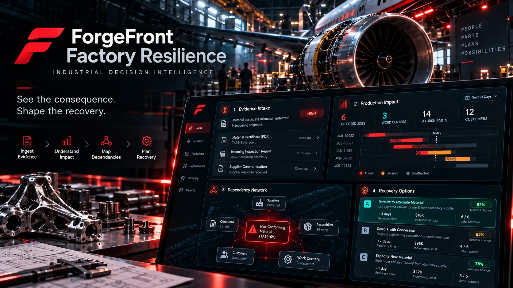

<p align="center">
  
</p>

# ForgeFront Factory Resilience

**See the consequence. Shape the recovery.**  
**ForgeFront Systems** · An initiative of **Wake Industries**

Manufacturing is a living network of suppliers, materials, people, machines, schedules, quality records, and customer commitments. **Factory Resilience brings those relationships together**, turning one operational disruption into a clear picture of its consequences and the most practical ways forward.

**Detect → Connect → Understand → Simulate → Decide → Recover**

---

## One discrepancy. Every consequence in view.

The aerospace factory demonstration begins with a material-certification conflict and traces its impact through the production system. Teams can investigate the source record, see the affected work, compare realistic recovery alternatives, and respond when conditions change again.

| Factory simulation | Connected operational view |
|:--|:--|
| **40** production orders | Evidence-to-job relationships |
| **4** CNC work cells | Capacity-aware scheduling |
| **7** affected production jobs | Targeted consequence tracing |
| **178** material units associated with the incident | Material allocation and exposure |
| **4** recovery approaches | Side-by-side response planning |

**The defining experience:** introduce a second disruption, such as a machine outage or supplier delay, and immediately see how the recovery decisions must change.

## Built for aerospace manufacturing complexity

Factory Resilience is designed around a problem familiar to large aerospace manufacturers: a single change in material quality, supplier availability, tooling, or production capacity can create a cascade across an entire program.

### Boeing | Production continuity at scale


Imagine linking material certificates, fuselage and engine dependencies, production cells, and final-assembly schedules in one coherent operational picture.

**Where Factory Resilience could make a difference:**

- **Higher production efficiency:** identify downstream conflicts earlier and keep unaffected work moving rather than pausing an entire queue.
- **Better on-time performance:** compare feasible ways to regain schedule, from qualified alternate supply to shift and work-center reallocation.
- **Lower rework exposure:** identify questionable material or process evidence before it propagates into downstream assembly.
- **Faster recovery decisions:** put production, purchasing, quality, and scheduling teams on the same evidence-backed plan.

**Metrics to improve:** on-time delivery, schedule adherence, disruption-to-decision time, first-pass yield, and rework hours per incident.

### Lockheed Martin | Mission-critical manufacturing readiness


In high-consequence aerospace programs, a missing qualified component, a supplier exception, or a production constraint must be understood through its program-level dependencies.

**Where Factory Resilience could make a difference:**

- **Fewer avoidable escapes:** tie a discrepancy to its originating record and affected assemblies before it becomes a late-stage quality event.
- **Stronger operational proficiency:** provide teams with a repeatable, traceable workflow for evaluating complex manufacturing exceptions.
- **More resilient supply chains:** identify single points of failure and evaluate qualified alternatives within defined constraints.
- **Reduced schedule uncertainty:** demonstrate how a disruption changes available capacity, priority work, and realistic recovery paths.

**Metrics to improve:** first-pass yield, nonconformance aging, recovery cycle time, supply-risk lead time, and schedule stability.

### Airbus | Connected industrial operations


A geographically distributed production system makes coordination as important as the individual manufacturing steps. Factory Resilience could connect supplier evidence, plant capacity, material availability, and aircraft-program milestones.

**Where Factory Resilience could make a difference:**

- **Greater cross-site visibility:** identify how a late or nonconforming part affects work across plants and assembly stages.
- **Higher resource utilization:** simulate feasible reassignment of jobs, work cells, qualified inventory, and delivery priorities.
- **Fewer preventable disruptions:** detect contradictions early and focus interventions on the work actually affected.
- **Shorter recovery lead times:** compare alternatives under updated supply and capacity conditions instead of working from stale assumptions.

**Metrics to improve:** assembly flow efficiency, work-in-process aging, inventory shortages, on-time delivery, and mean time to recovery.

<sub>These aerospace visuals illustrate proposed use cases, not live customer deployments or partnerships. All dashboard values are conceptual, not manufacturer performance data.</sub>

---

## The measurable improvement opportunity

| Operating objective | How Factory Resilience approaches it | Pilot measurement |
|:--|:--|:--|
| **Increase manufacturing proficiency** | Connect investigation and decision-making across quality, supply chain, and production | Time per investigation; decisions per shift |
| **Reduce failure propagation** | Trace the precise lot-to-job-to-assembly relationship | Escaped discrepancies; affected units beyond the first detected point |
| **Reduce scrap and rework** | Flag evidence conflicts before additional value is added | Scrap cost; rework hours; first-pass yield |
| **Improve schedule recovery** | Evaluate material and capacity-constrained response paths | Mean time to recovery; schedule adherence |
| **Improve supplier responsiveness** | Connect source records, lead times, and alternate supply options | Supplier exception resolution time |
| **Increase decision confidence** | Show underlying evidence, assumptions, and operational tradeoffs | Time to a documented, evidence-backed decision |

The value is not an arbitrary percentage on a dashboard. It is a **repeatable way to measure whether teams make better decisions sooner, contain disruptions more precisely, and protect production throughput.**

## The intelligence loop

```text
DOCUMENTS & SIGNALS
        ↓
EVIDENCE RECONCILIATION
        ↓
MATERIAL & PRODUCTION DEPENDENCIES
        ↓
SCHEDULE / INVENTORY CONSEQUENCES
        ↓
ALTERNATIVE RECOVERY SCENARIOS
        ↓
OPERATOR-LED DECISION
        ↓
TRACEABLE INCIDENT RECORD
```

### What makes this distinctive

Factory Resilience does more than identify that something went wrong. It seeks to answer the questions an operator actually needs answered:

**What changed? What production is affected? What can still run? Which recovery options are feasible? What happens when the factory changes again?**

That last question is central. The system is being developed to make recovery plans *adaptive*, not static.

## The development program

The roadmap contains **13 structured build phases**, beginning with the factory foundation and extending through multi-document evidence reconciliation, AI reasoning, dependency analysis, recovery planning, operator experience, verification, and hackathon presentation.

| Explore the program | |
|:--|:--|
| [Master Build Phase Sheet](docs/MASTER_BUILD_PHASE_SHEET.md) | Complete 13-phase program, deliverables, roles, and acceptance criteria |
| [GitHub Phase Board](docs/PHASE_ISSUE_INDEX.md) | Direct links to each phase's issue and work tracking |
| [Development Roadmap](docs/BUILD_ROADMAP.md) | Delivery sequence and milestones |
| [Foundation Milestones](docs/BUILD_VERIFICATION_2026-10-17.md) | Recorded results from the first manufacturing scenario |

### Meta Global AI Developer Hackathon 2026

An application has been submitted for the [Meta Global AI Developer Hackathon](https://dev.meta.ai/events/global-hackathon), centered on intelligent evidence analysis, industrial operations, and actionable manufacturing decisions.

---

<p align="center"><strong>ForgeFront Systems</strong><br><em>Wake Industries</em></p>
