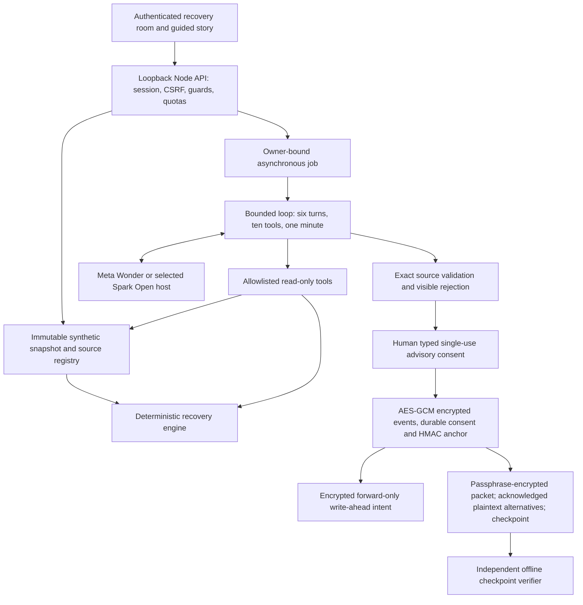

# ForgeFront Factory Resilience

Evidence before action. A synthetic manufacturing certificate discrepancy becomes a source-grounded recovery investigation, a deliberate human decision and an inspectable disruption-to-recovery history.

Product AI uses Meta Muse Wonder and Muse Spark Open only. Cursor and Codex are development tools. No model releases material, changes inventory or operates equipment: operationalRelease is always false. All factory data is synthetic and costs are illustrative.

## Run the judge demo

Requires Node with built-in fetch and test runner; browser verification also requires built-in WebSocket. Verified on Node 20.20.2 and Node 24.14.1; exact outcomes are recorded in the build report. Zero runtime npm dependencies and no build step.

From the repository root:

```sh
npm run demo --prefix hackathon
```

Open http://127.0.0.1:8791 and authenticate with the public test token `synthetic-browser-rehearsal`. Choose **Start guided synthetic scenario**, then **Show next action**. The guide opens sources, directs live Spark Open and Wonder runs on the same snapshot, human acceptance, a machine outage, reinvestigation, fresh acceptance and export. It advances on actual state, never a timer. Target narration is about three minutes; provider latency can extend a live rehearsal.

Securely provision MUSE_API_KEY (or MODEL_API_KEY), BASETEN_API_KEY and FIREWORKS_API_KEY in the parent process environment. Never paste values into source or a recorded terminal. Startup and authenticated UI show configuration presence only. The run badge shows actual returned model identity. Missing keys fail closed; Sample is explicit-only and labeled SAMPLE - OFFLINE; NO LIVE AI. No provider switch happens automatically.

The command uses fresh isolated private state and a random state key per launch, binds only to loopback and starts no inference automatically. Ctrl+C stops it. The public rehearsal token is never a production default. Persistent named operator/auditor seats and server-enforced read-only judge permissions, migration and secret provisioning are in [RUN_GUIDE.md](RUN_GUIDE.md).

## Why two Meta models?

Muse Spark Open investigates through bounded read-only evidence/calculation tools on Baseten or Fireworks. Muse Wonder provides a recovery story and counterfactual through the Meta Model API. Both use a tested JSON-envelope protocol; native Wonder tool support is not claimed. The engine computes stock, capacity, feasibility, hours and illustrative costs. Exact structured source claims are validated; narrative is clearly unvalidated advice. The observed-run comparison shows identity, duration and accepted/rejected counts without claiming a benchmark winner or inventing usage/cost.

Allowlisted identities: muse-wonder-1.0 at https://api.meta.ai/v1/responses; meta-models/muse-spark-open on Baseten; accounts/fireworks/models/muse-spark-open on Fireworks. Provider identity is self-reported, not independent attestation. No arbitrary inference URL, model override or non-Meta runtime AI.

## Architecture



A second shock changes the digest, invalidates prior decisions and prevents stale consent. Hash-chain/HMAC integrity is checked from disk at startup, on workflow operations, periodically and on demand. AES-256-GCM encrypts local events/anchors using an HKDF domain-separated key. Independently retained checkpoints detect inconsistency with a previously trusted head; substituting both exports defeats that trust assumption. Encrypted intent recovers interrupted appends by verified forward completion, never prior-anchor rollback. Pending consent survives encrypted replay and requires the same named identity after reauthentication. The primary packet export uses a separate passphrase with scrypt and AES-GCM. Advanced plaintext packet/report exports require explicit acknowledgement and must be protected by their holder.

## Reproduce checks

```sh
npm test --prefix hackathon
npm run smoke:browser --prefix hackathon
node hackathon/scripts/browser-smoke.mjs --live --guided
npm run smoke:investigation --prefix hackathon
```

Browser checks require installed Chrome or Edge (or CHROME_PATH); they fail rather than skip. Tools use disposable state and close server/browser in finally blocks. Live commands make real requests. Run-specific test counts, live/offline browser checks, scans and remaining gates are recorded in the reproducible checks listed in the root README. Earlier candidate evidence remains in evidence/run4; it is not a claim about a changed candidate. The independent runtime oracle is tests/unit/runtime-oracle.test.mjs; planning fixtures are not product inputs or observed results.

## Submission and boundaries

[Contributions](HACKATHON_CONTRIBUTIONS.md), [timed shots and captions](docs/DEMO_RUNBOOK.md), [plan coverage](docs/PLAN_COVERAGE.md), [security controls](SECURITY_CONTROLS.md), [release gates](docs/RELEASE_GATES.md) and [submission draft](docs/SUBMISSION_DRAFT.md) are text-only artifacts. Legacy root footage is excluded. No filming, publication, deployment, eligibility certification or submission receipt is claimed. Source stays private pending explicit release authorization and rights review.

[Submission checklist](docs/SUBMISSION_CHECKLIST.md) separates repo evidence from owner filming/upload/form actions. [Timed caption draft](docs/CAPTIONS_DRAFT.srt) must be retimed to actual narration; no film is claimed. Normal encrypted quota counters survive restart with the same private state directory/key; disposable demo launches intentionally start fresh. Failed-login audit growth is capped globally at twelve records per minute, including an omission warning. See [security controls](SECURITY_CONTROLS.md) for trust limits.


## Build run seven candidate controls

Run seven adds shared local export-passphrase feedback and API enforcement: 16–160 characters, at least eight distinct case-folded characters, and three distinct whitespace-separated words or three character types. Repeated/predictable prefixes are rejected. This heuristic does not prove entropy; use unique randomly selected words and keep the passphrase separately. Decryption retains the earlier length-only check so existing packets remain recoverable. Pinned scrypt and authenticated encryption remain unchanged.

Provider errors stop the investigation with recorded failure, no substitute narrative and no automatic retry. Select the route and press Investigate to start a deliberate new attempt. The UI labels the stopped live Meta investigation and preserves its trace. No provider switch or automatic Sample occurs. A fresh scenario clears consent, export acknowledgement/passphrase and guide state; reset records a new snapshot and opening decision state, preserved on verified restart. Earlier events remain retained.

Reproduce locally from the repository root with `npm run demo --prefix hackathon`; authenticate using the public synthetic rehearsal token printed by that command. Configure Meta keys only through environment variables. Start the guided scenario, inspect sources, run Spark Open and Wonder, review/type acceptance, simulate the second shock, investigate/accept again, verify and export. No model starts automatically. Stop with Ctrl+C. The clean-start integration test launches this entry with a fresh temporary directory and no stored configuration; it does not claim a separate clean-checkout trial.

Current-run evidence is under evidence/run7. Automated accessibility coverage is targeted: measured visible text contrast, visible form-control names, document language, no positive tabindex, keyboard skip link and responsive overflow. It is not a complete WCAG audit or physical-phone test. Source stays private; no publication, filming or submission is claimed. Cursor must audit the uncommitted diff before an actual freeze.
