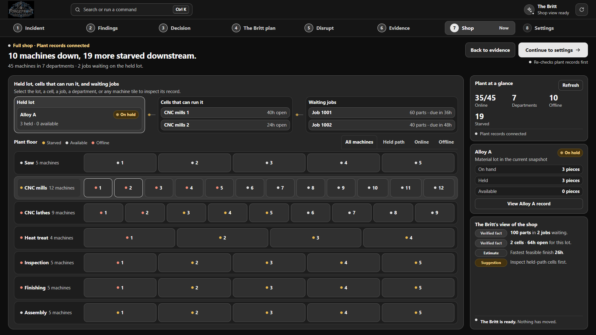

<!-- live-demo:start -->
**Live demo:** [Open the recovery room](https://forgefront-factory-resilience.onrender.com)
<!-- live-demo:end -->

# ForgeFront Factory Resilience

**The shop floor is in trouble. The Britt finds the way forward. You make the call.**

Only **3 of 100 pieces arrived**. **10 of 45 machines are offline**, and **19 more are starved downstream**. ForgeFront connects the held material, source evidence, machine capacity and waiting orders so you can choose and authorize a recovery.

**The Britt** investigates with **Meta Muse Spark Open on Baseten**, while **Muse Wonder through the Meta Model API** supports recovery reasoning and planning. The recovery engine calculates feasibility, time and cost from the current plant snapshot.

Move through **Incident**, **Findings**, **Decision**, **The Britt plan**, **Disrupt**, **Evidence**, **Shop** and **Settings**. Compare recovery paths, authorize your choice, inspect the job assignments and test how another lost cell changes capacity.

[See every screen and the full product walkthrough](../README.md) � [Run it yourself](RUN_GUIDE.md) � [Meta model integration](docs/META_MODEL_USAGE.md)

Built by **ForgeFront Systems**.
