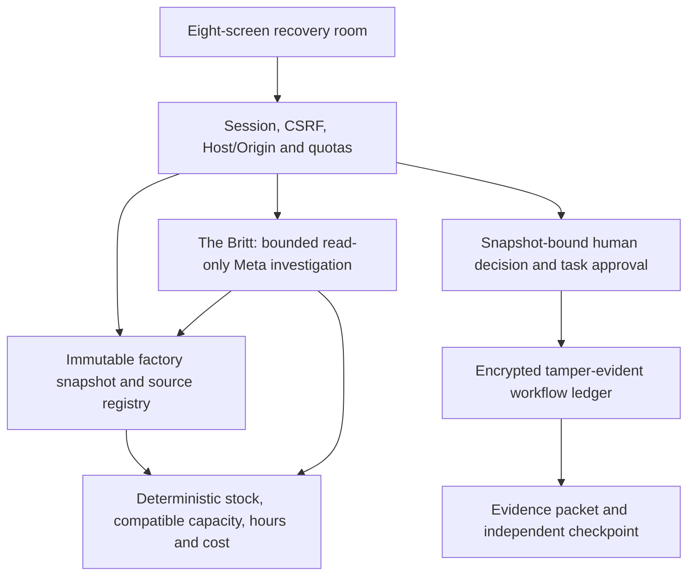

# Architecture

The browser recovery room connects source records, deterministic recovery calculations, bounded Meta investigation and human-authorized workflow transitions.

## Browser and server

`public/index.html` loads `public/ui/kit.mjs`, shared `theme.css` and eight screen modules: Incident, Findings, Decision, The Britt plan, Disrupt, Evidence, Shop and Settings. Model/source strings are escaped or rendered as text. Browser displays use API payloads; the authoritative recovery math and workflow state live on the server. Historical tests for the retired guided UI remain retained separately.

`server.mjs` serves allowlisted assets and authenticated APIs. `src/security/meta-handler.mjs` enforces roles, fields, session/CSRF and bounded inference. The public launcher creates isolated visitor workspaces with spending limits; persistent operator mode uses environment-provisioned identities.

`src/domain/scenario.mjs` validates immutable digest-bound records. `src/domain/engine.mjs` computes replenishment, verified-substitute and split-capacity recovery from current stock, material compatibility and usable machine hours. It calculates divisible throughput and presents due windows beside the recovery decision. Independent planning fixtures use the contract documented in [fixture alignment](FIXTURE_RUNTIME_ALIGNMENT.md).

## Models and authority

Muse Spark Open on Baseten reads evidence and calculated choices through bounded tools. Muse Wonder is a supported Meta Model API reasoning/task route. Fireworks is standby and stripped from public launch. Actual responding identities and failures remain in call records. [Model integration](META_MODEL_USAGE.md) explains limits and availability.

Review binds a feasible recomputed option, investigation, actor, snapshot, nonce and five-minute expiry. Human confirmation consumes that nonce once. A shock invalidates the prior decision and blocks unfinished work, requiring authorization against the new factory state. Task drafting and task approval are separate transitions. The competition build concludes with an approved decision package; production scheduling, inventory and machine connectors form the deployment layer.

## Evidence and storage

AES-256-GCM protects events, anchors, write-ahead intent and quota state. The hash chain and HMAC anchor detect tampering under the documented key and storage custody model. Authenticated forward recovery handles interrupted writes; corruption and committed truncation stop verification. Export uses a separate passphrase, and retained independent checkpoints establish a trusted prefix. Formal production certification remains a separate assurance track.

[API contract](API_CONTRACT.md) · [Security controls](../SECURITY_CONTROLS.md) · [Current evidence](../evidence/README.md)
