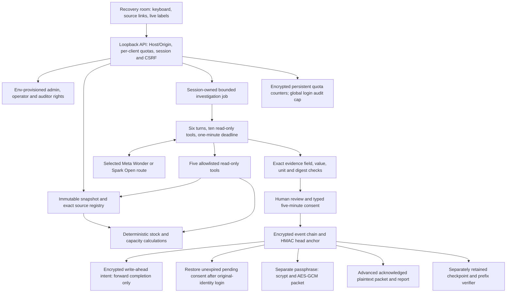

#The recovery room connects immutable sources, calculated options, bounded Meta investigation, typed human consent and encrypted evidence. [Current proof](../evidence/README.md) follows the complete path.

server.mjs assembles guards, static assets and authenticated API. src/security/meta-handler.mjs checks roles and workflow fields; unknown diagnostic routes never reach inference. /api/meta/respond records diagnostic inference; /api/workflow/provider-check records explicit nonce/identity checks; investigation endpoints run the bounded evidence workflow. No arbitrary URL/model override, shell, supplier messaging, inventory writes or model approval exists. Sample is explicit-only, cannot satisfy live guide stages and never replaces a failed/missing-key route.

src/domain/scenario.mjs builds and validates frozen digest-bound inputs. src/domain/engine.mjs computes wait, cost-first substitute and concurrent split options from stock, compatibility, hours and online state. src/domain/evidence.mjs builds the server registry. src/agent/tools.mjs exposes get_incident, read_evidence, list_impacted_jobs, compare_recovery_options and get_capacity. Structured claims require exact source fields/values/units; model interpretation is displayed alongside validated facts.

src/workflow.mjs serializes synchronous ledger transitions. Review binds run, original session actor, named identity, snapshot, feasible recomputed plan, nonce and five-minute expiry. Confirmation consumes once; shock/reset/revoke invalidate pending reviews. Sessions/jobs are ephemeral. Startup replays unexpired consent from encrypted events; resumption requires fresh authentication as the original identity/role and does not extend expiry. Same-process cross-session confirmation remains denied.

An append writes and flushes an encrypted intent, appends and flushes the encrypted event, atomically replaces the encrypted anchor, then replaces intent with its committed head/count. Startup validates the prior chain and exact intended event, HMAC and ciphertext suffix before completing forward. A newer committed anchor never authorizes reconstruction of a truncated log. A completed intent pins its current head/count and cannot serve as a prior-anchor rollback file. Corruption, unknown tails, wrong keys or inconsistent head/count fail closed. No historical-anchor backups or automatic damaged-ledger resets are created. Keep state on storage with the durability guarantees required by the operator.

Admin alone resets scenarios; named operators alone revoke recovery acceptance. Both may investigate/review/confirm and apply shocks. Auditors inspect/verify/export but cannot mutate. Role checks enforce the described task permissions. Login failures contain only a hashed direct client address and fixed reason. Quotas ignore forwarded headers; direct socket clients share limits behind NAT. Private directory ACLs and AES-GCM protect new event/anchor/intent files; plaintext exports require explicit acknowledgement. Stable key and anchor custody protect the ledger trust boundary; retained plaintext backups require the same private storage controls as plaintext exports.

Independent planning fixtures are a different schema and scheduling model. [FIXTURE_RUNTIME_ALIGNMENT.md](FIXTURE_RUNTIME_ALIGNMENT.md) lists every material difference and identifies the runtime oracle. Neither planning expected outputs nor retained evidence drive production calculations.

