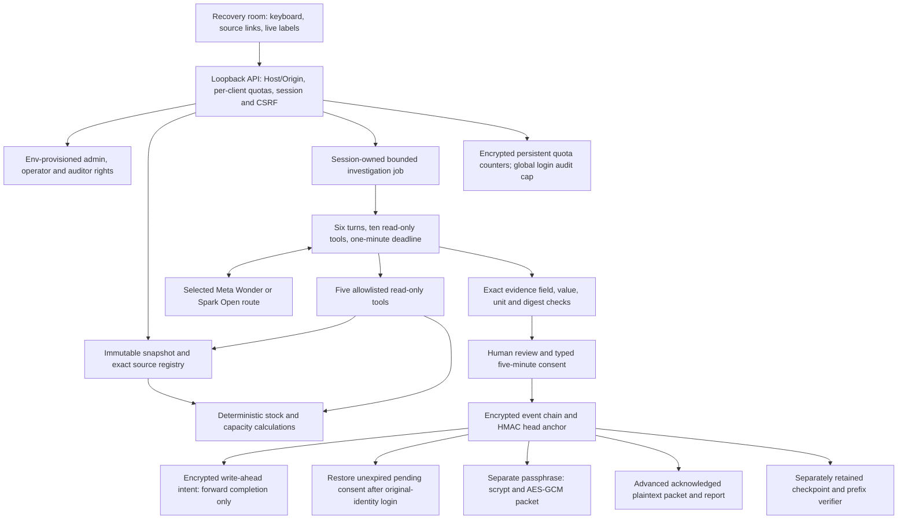
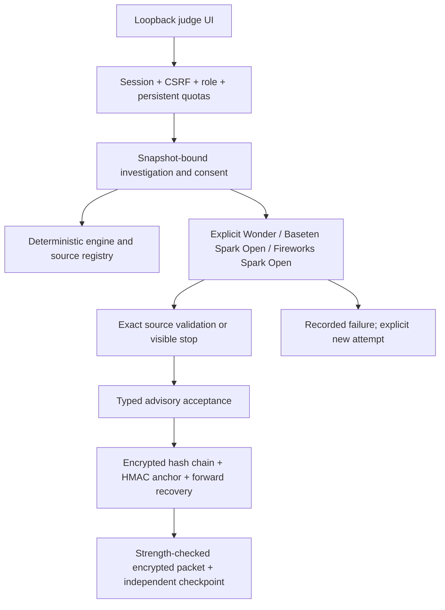

# Recovery-room architecture

Synthetic manufacturing data and illustrative costs only. Meta models investigate and explain; deterministic code controls feasibility. Every advisory decision keeps operationalRelease false. Current implementation evidence belongs to the root run-six report and evidence/run6; this document is not a compliance or safety certification.

server.mjs assembles guards, static assets and authenticated API. src/security/meta-handler.mjs checks roles and workflow fields; unknown diagnostic routes never reach inference. Only /api/meta/respond runs diagnostic provider inference; investigation endpoints run the bounded evidence workflow. No arbitrary URL/model override, shell, supplier messaging, inventory writes or model approval exists. Sample is explicit-only, cannot satisfy live guide stages and never replaces a failed/missing-key route.

src/domain/scenario.mjs builds and validates frozen digest-bound inputs. src/domain/engine.mjs computes wait, cost-first substitute and concurrent split options from stock, compatibility, hours and online state. src/domain/evidence.mjs builds the server registry. src/agent/tools.mjs exposes get_incident, read_evidence, list_impacted_jobs, compare_recovery_options and get_capacity. Structured claims require exact source fields/values/units; free model narrative stays visibly unvalidated.

src/workflow.mjs serializes synchronous ledger transitions. Review binds run, original session actor, named identity, snapshot, feasible recomputed plan, nonce and five-minute expiry. Confirmation consumes once; shock/reset/revoke invalidate pending reviews. Sessions/jobs are ephemeral. Startup replays unexpired consent from encrypted events; resumption requires fresh authentication as the original identity/role and does not extend expiry. Same-process cross-session confirmation remains denied.

An append writes and flushes an encrypted intent, appends and flushes the encrypted event, atomically replaces the encrypted anchor, then replaces intent with its committed head/count. Startup validates the prior chain and exact intended event, HMAC and ciphertext suffix before completing forward. A newer committed anchor never authorizes reconstruction of a truncated log. A completed intent pins its current head/count and cannot serve as a prior-anchor rollback file. Corruption, unknown tails, wrong keys or inconsistent head/count fail closed. No historical-anchor backups or automatic damaged-ledger resets are created. Storage hardware/OS power-loss durability is not independently certified.

Admin alone resets scenarios; named operators alone revoke advisory acceptance. Both may investigate/review/confirm and apply shocks. Auditors inspect/verify/export but cannot mutate. This is separated rights rather than two-person confirmation. Login failures contain only a hashed direct client address and fixed reason. Quotas ignore forwarded headers; direct socket clients share limits behind NAT. Private directory ACLs and AES-GCM protect new event/anchor/intent files; plaintext exports require explicit acknowledgement. Historical backups and a privileged process/key/all-anchor attacker remain outside that guarantee.

Independent planning fixtures are a different schema and scheduling model. [FIXTURE_RUNTIME_ALIGNMENT.md](FIXTURE_RUNTIME_ALIGNMENT.md) lists every material difference and identifies the runtime oracle. Neither planning expected outputs nor retained evidence drive production calculations.

# Build run six: current controls and evidence

This run adds a global rolling failed-login audit budget: at most twelve login_failed records in any minute across all socket identities, recovered from verified ledger history across restart. The first eleven retain hashed client identity and INVALID_CREDENTIAL; the twelfth marks GLOBAL_AUDIT_CAP_REACHED and furtherAttemptsOmitted. The marker warns that subsequent attempts may be omitted; it does not claim an exact attack count. No login failure initializes a snapshot. Continued attacks can produce capped growth over time; this is not a finite lifetime retention policy.

Normal startup persists independent API 240/min, login 12/min and authenticated Meta/workflow 120/min counters in encrypted quota files before granting requests. Counters retain hashed direct socket identities, bounded map size and original window starts. Corruption/wrong key/configuration mismatch blocks startup; clock rollback conservatively extends active windows. Files use flush plus atomic replacement, with no backup rollback. An interrupted pre-rename request is not granted. Quota files are separate from the audit chain; privileged file deletion/replacement or multiple simultaneous processes sharing a directory is outside this single-process local guarantee. Sessions remain ephemeral; the isolated demo deliberately uses fresh state/key each launch. NAT clients share a socket-identity budget.

Encrypted evidence packet export is now the primary UI action, available to authenticated readers including auditors. A separate 16–160 character passphrase derives a key with scrypt N=16384, r=8, p=1; fresh salt and IV protect each AES-256-GCM packet. No export passphrase is stored in the ledger or quota files. The browser clears the field on export/lock/expiry. This HTTP interface is loopback-only; no remote transport-security claim is made. Advanced plaintext JSON/Markdown downloads retain the exact API acknowledgement and PLAINTEXT EXPORT banners. Integrity checkpoints remain plaintext metadata. Historical exports/backups remain outside encryption claims.

Use a strong unique export passphrase; minimum length does not prove entropy. Losing it loses access. Securely provision FFR_EXPORT_PASSPHRASE and run `node hackathon/scripts/decrypt-export.mjs input.encrypted.json new-private-output.json` to produce intentional plaintext for inspection/checkpoint verification. The decoder refuses an existing output; wrong password or modified ciphertext fails authentication. Keep passphrase, decrypted packet and independently retained checkpoint secure and separate.

Tests: tests/unit/run6-controls.test.mjs, tests/unit/run6-export.test.mjs, tests/integration/run6-export.test.mjs and tests/integration/run6-quota.test.mjs. Current counts, scans, process cleanup and browser evidence are recorded in the reproducible checks listed in the root README. Prior run evidence remains historical. Meta-only providers, fail-closed keys, explicit Sample, verified ledger recovery, durable consent and separated rights remain unchanged. No external account, eligibility, filming, publication or submission evidence is invented.

## Build run seven candidate controls

Run seven adds shared local export-passphrase feedback and API enforcement: 16–160 characters, at least eight distinct case-folded characters, and three distinct whitespace-separated words or three character types. Repeated/predictable prefixes are rejected. This heuristic does not prove entropy; use unique randomly selected words and keep the passphrase separately. Decryption retains the earlier length-only check so existing packets remain recoverable. Pinned scrypt and authenticated encryption remain unchanged.

Provider errors stop the investigation with recorded failure, no substitute narrative and no automatic retry. Select the route and press Investigate to start a deliberate new attempt. The UI labels the stopped live Meta investigation and preserves its trace. No provider switch or automatic Sample occurs. A fresh scenario clears consent, export acknowledgement/passphrase and guide state; reset records a new snapshot and opening decision state, preserved on verified restart. Earlier events remain retained.

Reproduce locally from the repository root with `npm run demo --prefix hackathon`; authenticate using the public synthetic rehearsal token printed by that command. Configure Meta keys only through environment variables. Start the guided scenario, inspect sources, run Spark Open and Wonder, review/type acceptance, simulate the second shock, investigate/accept again, verify and export. No model starts automatically. Stop with Ctrl+C. The clean-start integration test launches this entry with a fresh temporary directory and no stored configuration; it does not claim a separate clean-checkout trial.

Current-run evidence is under evidence/run7. Automated accessibility coverage is targeted: measured visible text contrast, visible form-control names, document language, no positive tabindex, keyboard skip link and responsive overflow. It is not a complete WCAG audit or physical-phone test. Source is published in this repository for hackathon judging.

